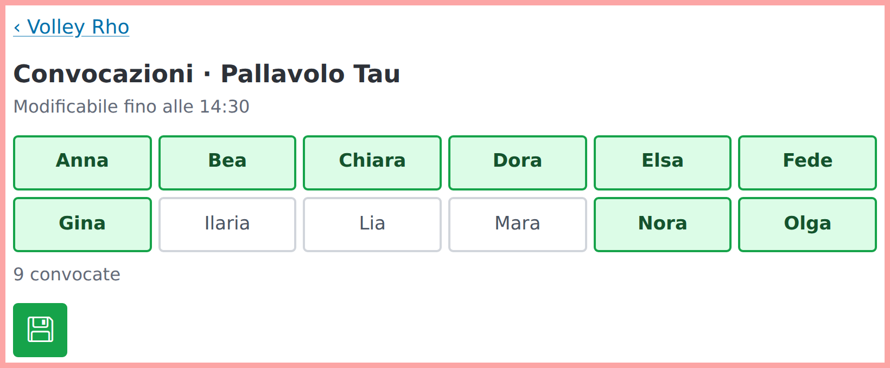

# Match tracker

A very small web app to follow volleyball matches point by point. A staff member
on the bench records points, timeouts and, if wanted, who scored; the families
who are not there follow live on their phones. No database, no accounts, no
cookies, no statistics. `docs/contract.md` is the interface (team files, event
log, endpoints).

## What it looks like

The example team `rho` (invented names), in Italian, the default of its team
file. Left, what a family sees on a phone; right, the bench's scoring screen.

<p>


</p>

The coach's call-up of a match, on a tablet:



## Running it

```bash
uv sync
uv run match-tracker              # 127.0.0.1:8000, teams/ and data/
uv run match-tracker --teams teams --data data --logs logs --host 127.0.0.1 --port 8000
uv run match-tracker urls --base https://example.org   # every team's links, as Markdown
uv run match-tracker replay data/rho/1.journal.jsonl   # the log of a match, from its journal
```

It is a uv application: `uv build` makes a wheel that carries its own pages, and
`uv tool install .` puts `match-tracker` on the path.

`uv run match-tracker urls` prints the links of every team, as a Markdown table:
the family address is what families bookmark, the staff one is for the bench.
The server never logs them, since they are secret. Both are derived from the
team's file name (and the salt, if there is one), so they are the same at every
start. Each team is one file in `teams/` (`teams/rho.json` is an example), read
at start and again whenever it changes, so a late change to who is playing needs
no restart. The server writes `data/`, one event log per match with its
append-only journal (so that a lost log can be rebuilt: `match-tracker replay`),
and, when a salt is in `teams/salt`, the team files themselves through the pages
that edit them (`docs/contract.md`, *Editing*).

The server says nothing on the console but a failure to start. What the operator
needs goes to `logs/app.log` (rotated daily at midnight, 30 files kept; the
directory is set with `--logs` and is made readable by its owner only). It holds
no visitor's address and no link, and nothing is stored on a visitor's device.

The server stops within a few seconds of SIGTERM, even with families watching.

## The code

`src/match_tracker/` is the package: `teams.py` (team files, tokens, reload, and
the one safe way to save or create a team file), `rules.py` (the rules of a
match, with no I/O), `store.py` (the event logs on disk), `journal.py` (their
journals), `views.py` (the JSON of the contract), `limiter.py`, `oplog.py` (the
operator's log file), `server.py` (the app and `main`), and `static/` (the
pages, their scripts and `i18n.json`). `tests/` has a file per module and two
that drive a browser.

The pages are styled with Pico.css, and those that edit use the Bootstrap Icons
font for their buttons. Both are copied under `src/match_tracker/static/vendor/`
(MIT, each with its licence, versions 2.0.6 and 1.11.3), so that a visitor's
address goes to no other host; a test checks that no page loads from one.

## Privacy notice

Every public page links to `/privacy`, which serves `privacy.html` from the
directory of the team files (`teams/`). The notice is yours to write, as it
depends on who runs the service and what they do with it; without the file the
link leads to the usual not-found page.

## Behind a proxy

It listens on loopback only. To put it on the internet, run a proxy or a tunnel
(Cloudflare Tunnel, nginx) on the same machine and point it at the port. There
must be exactly one instance, with a `data/` directory that survives restarts,
and the proxy must pass the live stream (server-sent events) through as it is
produced; Cloudflare Tunnel does. Where and how to run it is up to you.

Requests naming a token the server does not know are limited to 10 a minute per
address, then answered `429`; a known token is never limited. The address is the
one uvicorn reports: it believes `X-Forwarded-For` from `127.0.0.1` and `::1`,
so a proxy on the same machine that sets that header needs nothing (check that
yours does), and another proxy has its address in `FORWARDED_ALLOW_IPS`. Without
that every visitor shares one count, which only makes a mistyped address answer
`429` sooner.

## Trying it

```bash
uv run pytest                     # all tests; the browser ones need Chromium
uv run match-tracker --teams teams --data /tmp/scratch-data
```

`teams/rho.json` is an example with invented names. A team file with real names
is kept out of git.

## Licence

GNU General Public License, version 3 or later: see `LICENSE`.
